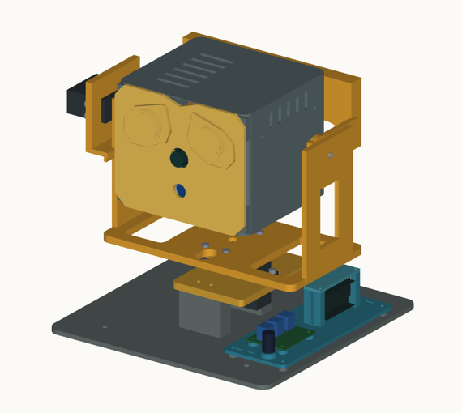
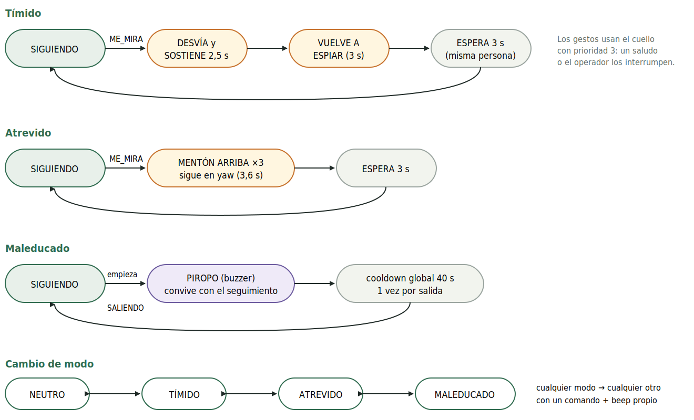
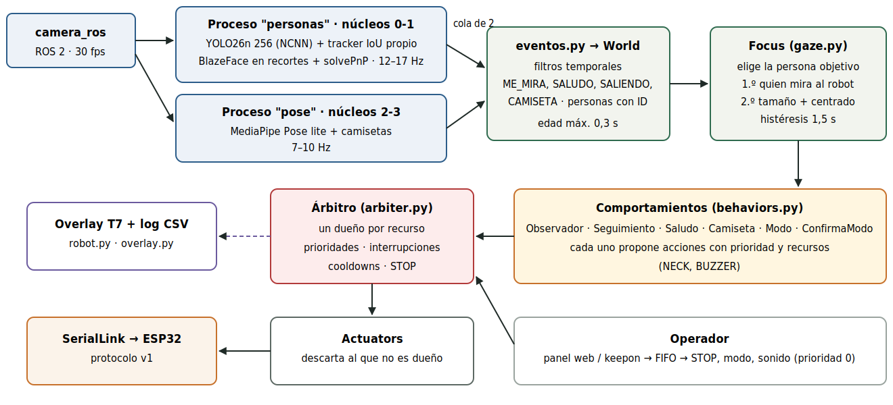
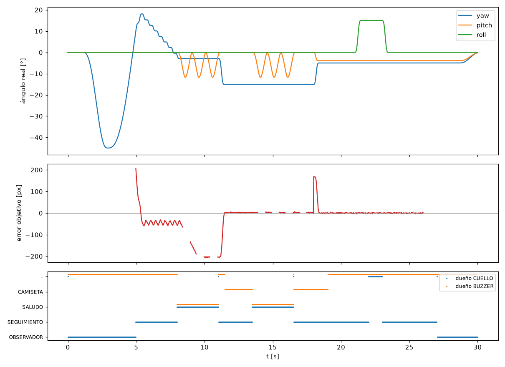

<div align="center">

# Keepon pro

**Cabeza robótica social de 3 grados de libertad con visión artificial**

µTP *Robótica Social* · Robótica II · Facultad de Ingeniería, Universidad Nacional de Asunción (FIUNA) · 2026




*Diseño mecánico propio v6 R4, impreso en 3D. La cámara es la nariz; la Raspberry Pi va dentro de la cabeza.*

</div>

Keepon detecta a las personas, las sigue con la mirada, responde a saludos y a quién lo mira, reconoce las camisetas de
**Olimpia** (toca la polca) y **Cerro** (abuchea), y tiene cuatro personalidades que se cambian desde el celular. Todo
corre en una Raspberry Pi 5 en Python; una ESP32-C3 mueve los tres servos con trayectorias suaves y toca los sonidos en
un buzzer, sin bloquearse nunca.

## Entregables

| | |
|---|---|
| 📓 **Informe técnico** (cuaderno Colab, ya ejecutado) | [`docs/informe/Informe_técnico_v3.ipynb`](docs/informe/Informe_t%C3%A9cnico_v3.ipynb) · versión anterior: [`Informe_técnico.ipynb`](docs/informe/Informe_t%C3%A9cnico.ipynb) |
| 📘 **Guía completa del proyecto** (PDF con diagramas) | [`docs/guia/Guia_Keepon_pro.pdf`](docs/guia/Guia_Keepon_pro.pdf): construcción, hardware, control, software y decisiones |
| ✅ **Consigna, casilla por casilla** | [`docs/CHECKLIST_TP.md`](docs/CHECKLIST_TP.md) (qué pide la consigna y dónde está en el código) |
| 📄 **Consigna** | [`docs/2026S2uTP_RoboticaSocial.md`](docs/2026S2uTP_RoboticaSocial.md) |
| 🔌 **Diagrama eléctrico y del sistema** | [`docs/diagrama_sistema/`](docs/diagrama_sistema/index.html) |
| 🧩 **Diagramas editables** (draw.io) | [`docs/informe/diagramas/`](docs/informe/diagramas/LEEME.md) |

## Qué hace

| Situación | Respuesta del robot |
|---|---|
| No hay nadie | **Observador**: centra la vista y explora la escena con barridos lentos, sacadas rápidas a puntos de interés y pequeñas inclinaciones de roll |
| Aparece una persona | **Seguimiento**: la mira en un solo movimiento rápido y se queda quieto; prioriza a quien lo mira, con histéresis para no saltar entre personas |
| Alguien saluda con la mano | 3 cabeceos + sonido tipo R2D2 |
| Camiseta de **Olimpia** | Polca de Olimpia **sin dejar de seguir** a la persona (una vez por aparición) |
| Camiseta de **Cerro** | Abucheo. Las prendas lisas rojas o azules no disparan nada |
| Modo **Tímido** y alguien lo mira | Aparta la mirada y vuelve a espiar de a poco |
| Modo **Atrevido** y alguien lo mira | Sostiene la mirada y levanta el mentón |
| Modo **Maleducado** y alguien se va | Le silba un piropo |
| La persona queda quieta | **Curiosidad**: inclina la cabeza de costado |
| Operador (celular) | STOP enclavado, HOME, demostración de los 3 ejes, cambio de modo con su beep, sonidos y volumen |

<div align="center">


*Diagramas de estados de las personalidades.*
</div>

## Cómo funciona

<div align="center">

</div>

1. **Percepción** en dos procesos paralelos: personas con **YOLO26n** (NCNN, 256 px) + tracker propio por IoU + rostros con
   **MediaPipe BlazeFace** y orientación de la cara con solvePnP (12–17 Hz); pose del cuerpo con **MediaPipe Pose** y
   detector de camisetas propio por color y patrón (7–10 Hz).
2. **Modelo del mundo**: personas con ID y eventos con filtros temporales (ME_MIRA, SALUDO, CAMISETA_OLIMPIA,
   CAMISETA_CERRO, SALIENDO).
3. **Foco de atención**: elige a quién mirar (primero a quien mira al robot; si no, la persona más grande y centrada),
   con 1,5 s de histéresis.
4. **Comportamientos** que proponen acciones y un **árbitro propio** que reparte los dos recursos exclusivos
   (cuello y buzzer) por prioridad, con interrupciones, cooldowns y STOP. Nunca hay dos controladores escribiendo al cuello.
5. **ESP32-C3**: perfil trapezoidal con **curva S** a 100 Hz por eje (límites de posición, velocidad, aceleración y jerk),
   sonidos sin `delay()`, watchdog de 500 ms y STOP enclavado. Protocolo serie propio: [`docs/PROTOCOLO.md`](docs/PROTOCOLO.md).

| Prioridad | Comportamiento | Cuello | Buzzer |
|---|---|---|---|
| 0 | Operador: STOP, HOME, Ejes, sonidos | ✔ | ✔ |
| 1 | Saludo | ✔ | ✔ |
| 2 | Camiseta | | ✔ |
| 3 | Reacción de personalidad | ✔ | ✔ |
| 4 | Seguimiento | ✔ | |
| 5 | Observador | ✔ | |

Polca y seguimiento usan recursos distintos, así que conviven: el robot silba mientras sigue a la persona. Si esa
persona saluda, el saludo (prioridad 1) interrumpe a los dos y al terminar el seguimiento retoma el cuello. Así se ve en
el escenario simulado de 30 s del repositorio (`python scripts/sim_scenario.py --plot`), con el árbitro, los
comportamientos y el control reales:

<div align="center">

</div>

## Resultados medidos

| Métrica | Resultado | Pedido por la consigna |
|---|---|---|
| Detección de personas (Pi 5, robot completo) | **12–17 Hz** | ≥ 10 Hz |
| Lazo de decisión y control | 36–39 Hz | — |
| Latencia evento → respuesta (estimada) | ≈ 130–170 ms | ≤ 300 ms |
| Camiseta de Olimpia / Cerro (cámara del robot, 60 s) | 82 % (99 % desde los 10 s) / 98 % | — |
| Falsos positivos con remeras lisas roja y azul | 0 % | rechazar prendas lisas |
| Firmware en la ESP32 real | 30/30 pruebas; PING → ACK 4,4 ms | — |
| Conflictos de recursos en el escenario simulado | 0 violaciones | un dueño por recurso |

Detalle en el informe (sección 11) y en [`docs/ESTADO_PI.md`](docs/ESTADO_PI.md).

## Hardware

| Parte | Modelo |
|---|---|
| Procesamiento | Raspberry Pi 5 (4 GB), Ubuntu 24.04 + ROS 2 Jazzy (ROS 2 solo para leer la cámara) |
| Cámara | Camera Module 3 NoIR (IMX708), en la nariz, montada invertida |
| Microcontrolador | ESP32-C3-DevKitM-1 por USB serie: pulsos de los servos y tonos del buzzer |
| Servos | yaw: DSSERVO RDS3218 (GPIO0) · pitch: TowerPro MG996R (GPIO1) · roll: TowerPro MG996R (GPIO4) |
| Buzzer | módulo pasivo MH-FMD a 3V3, en GPIO5 (frecuencia variable: melodías) |
| Alimentación | servos: fuente de laboratorio a 6 V · Pi: powerbank Xiaomi PB2020MI · GND común |
| Mecánica | diseño propio v6 R4 impreso en 3D: [`docs/diseno_v6/`](docs/diseno_v6/README.md) |

Conexiones y alimentación: [`docs/HARDWARE.md`](docs/HARDWARE.md).

## Probarlo sin el robot

```bash
uv venv .venv --python 3.12 && . .venv/bin/activate
uv pip install torch torchvision --index-url https://download.pytorch.org/whl/cpu   # solo x86
uv pip install -r requirements.txt

PYTEST_DISABLE_PLUGIN_AUTOLOAD=1 python -m pytest -q   # 257 tests (la variable evita los plugins de ROS 2)
python scripts/sim_scenario.py --plot                   # escenario simulado de 30 s -> logs/sim_scenario.png
```

Algunos tests compilan el núcleo del firmware en C++ y lo comparan paso a paso con el simulador: necesitan `g++`.
El informe también se puede abrir en Colab y ejecutar: descarga este repositorio y lee los parámetros reales.

## Instalación en la Raspberry Pi 5

1. Copiar el repo a `~/keepon` (por ejemplo, con `rsync`; ver [`docs/PI.md`](docs/PI.md)).
2. Entorno `~/keepon_env`: `python3 -m venv --system-site-packages ~/keepon_env` (así ve `rclpy`) e instalar
   `requirements.txt`. La cámara se lee con el nodo `camera_ros` de ROS 2 Jazzy.
3. `sudo usermod -aG dialout $USER` para usar el puerto serie de la ESP32 sin `sudo`.
4. Firmware de la ESP32-C3: `bash scripts/cargar_firmware.sh` ([`firmware/README.md`](firmware/README.md)).
   **Sostener la cabeza** mientras carga: los MG996R quedan flojos sin pulso.
5. `bash ~/keepon/scripts/keepon instalar` instala los servicios de usuario (`keepon` y `keepon-panel`).

## Uso

**Encender:** primero el powerbank (Pi) y después los 6 V de los servos, con la cabeza cerca de HOME. **Apagar:** al revés.
En la Pi, `keepon` es `bash ~/keepon/scripts/keepon`.

| Qué | Cómo |
|---|---|
| Arrancar / parar | panel del celular, o `keepon arrancar` / `keepon parar` (al parar vuelve a HOME) |
| Panel del celular | `http://<ip-de-la-pi>:8081`: Encender / Apagar, modos, STOP, Home, Resume, Ejes, sonidos y volumen |
| Monitoreo (overlay) | `http://<ip-de-la-pi>:8080/stream_viewer?topic=/keepon/overlay` |
| Personalidad | `keepon n` (Neutro) · `keepon t` (Tímido) · `keepon a` (Atrevido) · `keepon m` (Maleducado), cada una con su beep |
| STOP y HOME | `keepon stop` / `keepon home` (quedan enclavados) · `keepon resume` los libera |
| Demostración de los ejes | `keepon ejes`: recorre yaw, pitch y roll en ~15 s y vuelve |
| Sonidos | `keepon sonido POLCA` (también R2D2, ABUCHEO, PIROPO, DESAPROBACION) · `keepon volumen 0-100` |
| Estado y log | `keepon estado` · `keepon log` (CSV con marca de tiempo en `logs/run_*.csv`) |

Desde una notebook con acceso SSH a la Pi, `scripts/k <comando>` hace lo mismo (`KEEPON_PI=usuario@host`).

## Código

```
keepon/             el robot en Python          tests/            257 tests con pytest
firmware/           ESP32-C3 (Arduino)          scripts/          arranque, panel, carga de firmware, benchmarks
pruebas_servos/     banco de servos             pruebas_buzzer/   buzzer y sonidos (polca transcrita a mano)
pruebas_camisetas/  detector de camisetas       docs/             informe, guía, arquitectura, hardware, CAD
```

| Módulo | Qué hace |
|---|---|
| `keepon/perception.py`, `tracker.py` | Procesos de percepción y tracker IoU propio |
| `keepon/eventos.py`, `camiseta.py`, `world.py` | Eventos con filtros temporales, detector de camisetas y modelo del mundo |
| `keepon/gaze.py` | Control de mirada por objetivo y foco de atención con histéresis |
| `keepon/behaviors.py` | Observador, Seguimiento, Saludo, Camiseta, Ejes y los cuatro modos |
| `keepon/arbiter.py`, `actuators.py` | Árbitro de recursos y filtro por dueño |
| `keepon/trajectory.py` | Trayectorias con límites y curva S (el firmware porta la misma lógica) |
| `keepon/protocol.py`, `link.py`, `sim_esp32.py` | Protocolo serie, enlace y ESP32 simulada (especificación ejecutable del firmware) |
| `keepon/robot.py`, `overlay.py` | Lazo principal, log CSV y overlay de monitoreo |
| `config.yaml` | **Todos** los parámetros: límites, umbrales, cooldowns, prioridades, sonidos |

Arquitectura en detalle: [`docs/ARQUITECTURA.md`](docs/ARQUITECTURA.md). Por qué se eligió cada cosa:
[`docs/DECISIONES.md`](docs/DECISIONES.md). Historia del trabajo: [`docs/BITACORA.md`](docs/BITACORA.md).

## Modelos preentrenados y créditos

- **YOLO26n** de [Ultralytics](https://github.com/ultralytics/ultralytics), exportado a [NCNN](https://github.com/Tencent/ncnn): detección de personas.
- **MediaPipe** de Google ([google-ai-edge/mediapipe](https://github.com/google-ai-edge/mediapipe)): BlazeFace (rostros) y Pose lite (saludo y torso).
- [**camera_ros**](https://github.com/christianrauch/camera_ros) (ROS 2) para leer la cámara.

El árbitro, los comportamientos, el control de la cabeza, el tracker, los eventos, el detector de camisetas, el firmware
y el diseño mecánico son **desarrollo propio** del grupo.
