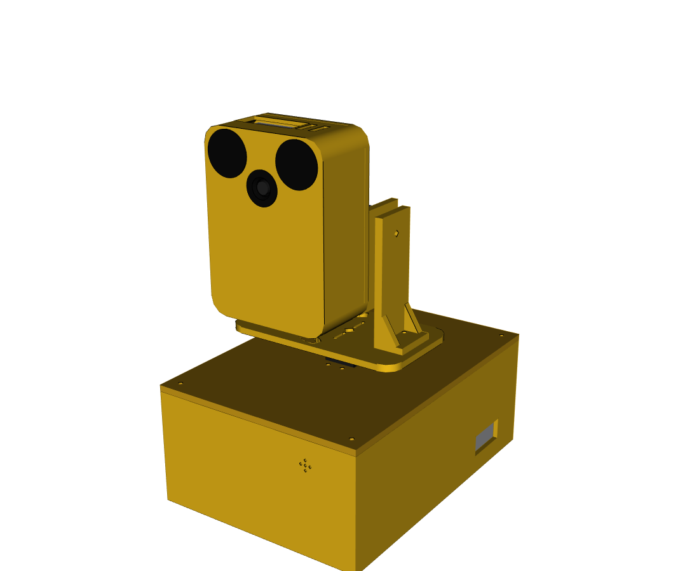
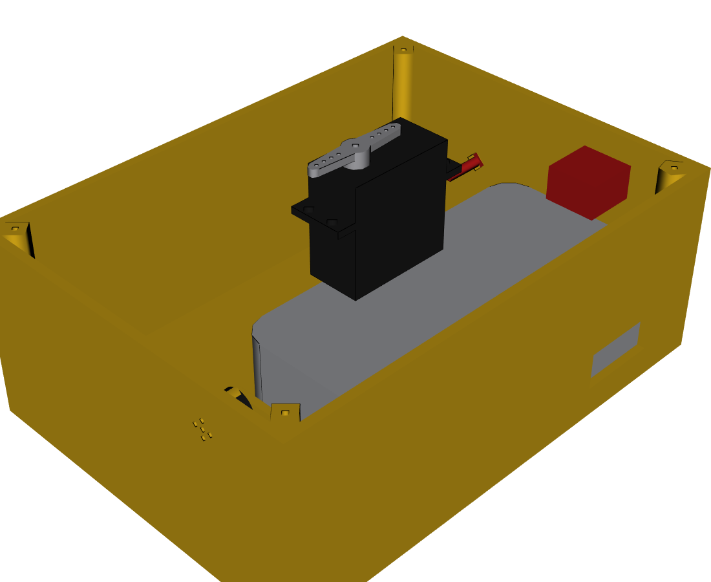

# Keepon pro v4: cabeza de la v3 + cuello de la v1 + alimentación en la base

- **De la v3** (`../keepon_v3_cad/`): la cabeza completa (Pi 5 parada adentro, cámara-nariz, ojos, cinta con la U y el doblez en Z), los tres servos, los soportes de pitch, la horquilla y los brazos dobles. Son las mismas piezas, sin cambios.
- **De la v1** (`../keepon_mg996r_step/`, `cuerpo.png`): la disposición de los motores. Es una columna compacta: el yaw vertical en la base, una **base en U** sobre su brazo, y **el eje de pitch justo encima del eje de yaw**. En la v3 el pitch estaba 20 mm adelante, sobre un plato de Ø146.
- **Nuevo:** la caja base lleva el **powerbank Xiaomi** para la Pi y, en la pared de atrás, **dos bornes para la fuente de laboratorio** que alimenta los servos (decisión del 14/10). Adelante, en una bahía, van la bornera de 6 V, la ESP32 y el buzzer.
- **Salieron la LiPo Zeee y el regulador de 6 V.** Su lugar queda libre; la caja conserva la medida (ver "Achicar la caja" más abajo).



## Medidas

| | v3 | v4 |
|---|---|---|
| Altura total | 223,5 mm | 223,5 mm |
| Caja base (con tapa) | 200 × 190 × 74 mm | **182 × 133 × 74 mm** |
| Plataforma de yaw | plato Ø146 (57 cm³) | **base en U de 64 × 116 mm** (26 cm³) |
| Eje de pitch respecto del de yaw | 20 mm adelante | **encima** (como la v1) |
| Carga sobre el eje del yaw (sin rodamiento) | 326 g a 39 mm → 1,26 kgf·cm | **295 g a 28 mm → 0,81 kgf·cm** |
| Cabeza | 75 × 104 × 40 mm | igual |

Con el pitch sobre el yaw, el centro de masa de lo que gira queda más cerca del eje: el momento de vuelco sobre el RDS3218 baja un 35 %. Como no hay rodamiento, es la mejora más importante para el yaw.

## Base



Vista de arriba (+X es la cara del robot):

```
 atrás (−X)                                                  adelante (+X)
 ┌──────────────────────────────────────────────────┬──────────────────┐
 │ [interruptor de los servos]                      │ ESP32 (parada)   │ ← buzzer en la pared
 │  POWERBANK XIAOMI 128 × 73 × 32 (5 V → Pi)       │ bornera 5 V      │   (agujeros de sonido)
 │                    ┌──────┐                      ├──────────────────┤
 │─ ─ ─ ─ tabique ─ ─ │ YAW  │ ─ ─ ─ ─ ─ ─ ─ ─ ─ ─  │   ○ capacitor    │
 ◎ bornes  (lugar libre│RDS3218 (cuelga de la tapa)  │ BORNERA 6 V      │
 ◎ 6 V    de la LiPo) └──────┘   ○ paso de cables   │ (+6 V y GND)     │
 └──────────────────────────────────────────────────┴──────────────────┘
```

- **Powerbank acostado** contra la pared de atrás, del lado izquierdo, con un tabique del lado del hueco y un tope adelante. Se fija con velcro adhesivo en el piso.
- **Bornes de 6 V** (banana de 4 mm, rojo y negro, 19 mm entre centros) en la pared de atrás, del lado derecho, por debajo del interruptor. Agujeros de Ø8: medir el borne que compren. Por adentro dan al **lugar libre de la LiPo**, que queda para el cableado y el bucle del yaw.
- **El servo de yaw cuelga de la tapa** (con la brida por debajo, como en la v3).
- **Bahía de adelante:**
  - la **bornera de 6 V** (20 × 40 mm), donde estaba el regulador: reparte +6 V y GND a los tres servos (el capacitor de 2200 µF se sacó el 26/10; el modelo todavía lo dibuja). Va con 2 tornillos M3 al piso o con cinta doble faz;
  - la **ESP32** va parada en `porta_esp32`, tomada de los extremos cortos para que los pines queden libres, con un paso para el micro-USB;
  - la **bornera de 5 V** (2 polos): llega el cable USB-A del powerbank y sale el de 20 AWG a la Pi;
  - el **buzzer**, en un aro de la pared de adelante con 5 agujeros para el sonido.
- **Pared de atrás:** el interruptor de los servos (corte de 19,2 × 12,8), por encima del powerbank, y los dos bornes. **Pared izquierda:** una ranura frente al powerbank para su cable y su botón (se carga sin abrir la caja).
- **Tapa:** 4 tornillos M3 a columnas que cuelgan de las esquinas.

## Alimentación

```
 Fuente de laboratorio ─ bananas 18 AWG ─ bornes ─ interruptor ─ bornera 6 V ─┬─ RDS3218 (yaw)
 (6,0 V, límite 4–5 A,    (~1 m)          (pared   (solo +6 V)                ├─ HS-7955TG (pitch)
  sobre la mesa)                           de atrás)                          ├─ MG996R (roll)
                                                                              └─ GND ─┐
 Powerbank Xiaomi ─ USB-A ─ bornera 5 V ─ 5 V / GND (20 AWG) ─▶ GPIO 2/4 y 6 de la Pi 5 │ GND común
                                                                                       │ (por la ESP32)
 Pi 5 (cabeza) ─ USB-A ─▶ micro-USB de la ESP32 (base) ─ GPIO0/1/4 ─ señales ──────────┘
                                                        └ GPIO10 ─ módulo buzzer (VCC 3V3)
```

Son **dos fuentes separadas**: los picos de los servos (sobre todo el HS-7955TG) quedan en el bus de 6 V y no reinician la Pi. Lo único que se une es el GND.

- **Pi 5 con el powerbank:** el puerto USB-C de la Pi queda tapado por la cinta (como en la v3), así que entra **por el GPIO** (5 V en los pines 2 y 4, GND en el 6). El powerbank da 5 V / 3 A por puerto sin negociar PD: la Pi arranca, avisa que la fuente no es de 5 A y **limita los USB a 600 mA**. Eso alcanza para la ESP32. La Pi consume ~7 W típico y 12 W de pico, unos 2,4 A: entra en los 3 A.
  - Duración estimada: 20 000 mAh × 3,7 V ≈ 74 Wh; con ~65 Wh útiles a 5 V y 7 W, **unas 9 h**.
  - Usar 20 AWG de la base a la cabeza (≈ 0,8 m ida y vuelta: ≈ 0,08 V de caída a 3 A). Medir que lleguen ≥ 4,9 V a los pines con la percepción corriendo.
  - **Desde la salida USB-A del powerbank:** el USB-A entrega 5 V sin negociar, así que alcanza con un cable USB-A macho cortado a dos hilos (que sean de ≥ 22 AWG: muchos cables USB traen hilos de 28 AWG y caen tensión a 3 A) hasta la bornera de 5 V. **No hace falta la placa USB-C con resistencias de 5,1 kΩ.**
  - **Si al armar la cabeza el USB-C de la Pi queda libre** (depende de hacia dónde sale la cinta, `PI_CSI_SALIDA`, sin verificar), mejor todavía: un cable USB-C acodado directo del powerbank a la Pi. Así funciona hoy en el banco, conserva la protección de entrada de la Pi y se eliminan la bornera de 5 V y el cable al GPIO.
  - **No forzar `usb_max_current_enable`** en la Pi: el powerbank no da más de 3 A.
- **Servos con la fuente de laboratorio:** **6,0 V** (máximo absoluto 7,4 V: el MG996R y el RDS3218 no aguantan más). En uso normal los tres piden 2–3 A, con picos de ~1 A por servo en los giros rápidos; trabados, 2,5–4,2 A cada uno.
  - **Límite de corriente en 4–5 A** (≥ 6 A si la fuente lo permite). Con 3 A o menos, en los movimientos bruscos la fuente entra en limitación, baja la tensión y los servos tiemblan o pierden fuerza.
  - **No usar la ALP002** (1,5 A, entrada de 110 V).
  - Cable de 18 AWG o más grueso hasta los bornes: el cable largo cae tensión y tiene inductancia (sin el capacitor, mejor que sea corto).
- **Interruptor de los servos:** corta solo el +6 V. Es la parada de emergencia física y la **única forma de aflojar el HS-7955TG** (sin pulso mantiene la posición con fuerza; el STOP del firmware lo congela, no lo afloja). Que sea de ≥ 10 A.
- **GND común:** el negativo de los bornes (bus de 6 V) se une al GND de la ESP32. Sin GND común, los servos no se mueven. La Pi y el powerbank quedan unidos a esa masa por el USB.
- **Secuencia:**
  1. Encender: primero el powerbank (arranca la Pi y la ESP32 toma 5 V por el USB), después la fuente con el interruptor de los servos, con la cabeza cerca de home: el HS-7955TG salta a velocidad máxima con el primer pulso.
  2. Apagar: primero el interruptor de los servos (o la fuente), después la Pi.
  3. Antes de conectar o cambiar un servo, cortar los 6 V (en el banco, enchufar uno en caliente desconectó la ESP32 del USB).

## Cableado por las articulaciones

| Articulación | Qué cruza | Cómo |
|---|---|---|
| **Yaw** (±70°) | 5 V + GND de la Pi (20 AWG), USB Pi → ESP32, cables de servo del HS y del MG996R (3 + 3 hilos) | Pasan por el **paso fijo de la tapa** (Ø10, a 26 mm del eje, hacia −Y) y por la **ranura en arco de la base en U** (±72°), que siempre queda sobre el paso. Adentro de la caja, dejar un bucle de ~10 cm en el lugar libre de la LiPo para los ±70°. El cable del RDS3218 ya está adentro. |
| **Pitch** (−20/+30°) | Lo mismo menos el HS, que es fijo al soporte izquierdo | Bajan por detrás de la horquilla, por la ventana de su piso, con un bucle de servicio cerca del eje de pitch. |
| **Roll** (±20°) | 5 V + GND de la Pi y USB a la ESP32 (salen de la cabeza) | Bucle alrededor del brazo del MG996R. |
| Dentro de la cabeza | Cinta de la cámara | **No cruza ninguna articulación**: la Pi y la cámara giran juntas (U + doblez en Z, ver la v3). |

## Uniones

| Unión | Elementos |
|---|---|
| Tapa → caja | 4 × M3 × 16 autorroscantes a las columnas |
| RDS3218 → tapa | 4 × M3 + tuerca (brida por debajo de la tapa) |
| Base en U → brazo del yaw | 2 × M2 × 8 autorroscantes por las ranuras + el tornillo central del servo |
| Soportes de pitch → base en U | 2 × M3 + tuerca cada uno |
| HS-7955TG → soporte izquierdo | 4 × M3 + tuerca |
| Horquilla → brazo del HS | 2 × M2 × 8 por las ranuras + el central |
| Horquilla → soporte derecho | Pivote M4 × 20 con 2 arandelas y tuerca autofrenante |
| MG996R → horquilla | 4 × M3 + tuerca |
| Placa de roll → brazo del MG996R | 2 × M2 × 8 por las ranuras + el central |
| Pi 5 → placa de roll | 4 × M2,5 × 6 |
| Caja de la cabeza → placa de roll | 4 × M2,5 × 12 desde atrás |
| Cámara → cara | 4 × M2 × 5 a los separadores; nariz y ojos pegados |
| Bornera de 6 V, ESP32, powerbank | 2 × M3 × 8 al piso (o doble faz), `porta_esp32` y topes impresos; velcro debajo del powerbank |
| Bornes de 6 V → pared de atrás | La tuerca de cada borne, por adentro |

## Orden de montaje

1. Caja: velcro y powerbank, bornes e interruptor en la pared de atrás, bornera de 6 V, `porta_esp32` con la ESP32, buzzer en su aro. Cablear la potencia (ver arriba).
2. Tapa: atornillar el RDS3218 por debajo y llevar su cable a la ESP32. Pasar los cables que suben por el paso de la tapa y cerrar la caja.
3. Base en U al brazo del yaw (con el servo centrado en 1500 µs y la U mirando al frente), y los soportes de pitch a la U.
4. HS-7955TG al soporte izquierdo; horquilla con el MG996R al brazo del HS y al pivote M4.
5. La cabeza, como en la v3: placa de roll al brazo del MG996R, Pi, cinta (U + doblez en Z), cámara y caja de la cabeza.

## Verificado con el script

```bash
cd docs/keepon_v4_cad/fuente
~/cq_env/bin/python keepon_v4_cad.py --verificar   # STEP, STL, macro, lista de componentes, interferencias
~/cq_env/bin/python vistas.py                      # vistas/*.png
```

- **Sin interferencias** en la pose 0, en 15 poses de pitch × roll (pitch −32 / −16 / +11 / +22, roll −22 / 0 / +22) y con el yaw en ±70° con la nariz abajo.
- **Holgura mínima: 2 mm** (la horquilla contra el soporte derecho, igual que en la v3). La base en U se recortó adelante (x ≤ 32 mm) para que la cabeza no la toque con la nariz abajo y roll.
- La bornera, el capacitor y los bornes no tocan nada (pose 0, todas las piezas contra todas).

## SolidWorks

- `step/keepon_v4_ensamble.step`: el ensamble completo. Cada pieza impresa está en `step/` y `stl/`, y cada componente en `step/componentes/`.
- **Relaciones de posición:** la misma macro que en la v3, con las bisagras de la v4: `solidworks/keepon_v4_relaciones_PEGAR.txt`. Abrir el STEP, guardarlo como `.SLDASM` sin mover nada, pegar el texto en el editor de VBA y ejecutar `main`.
- `componentes_v4.txt`: todas las piezas con sus medidas, más la tornillería y los cables.

## Medir antes de imprimir

| Qué | Valor usado |
|---|---|
| Powerbank Xiaomi | 128 × 73 × 32 mm (aproximado, según la ficha) |
| Bornes de banana | agujero de Ø8, 19 mm entre centros (`BORNE_AGUJERO`, `BORNES_Y`) |
| Bornera de 6 V | 20 × 40 × 16 mm (`BORNERA6`) |
| Lo de la v3 | Cinta, cooler, brazo de los servos y salida de la cinta (ver `../keepon_v3_cad/README.md`) |

## Pendiente

- Probar la macro de relaciones en SolidWorks.
- Medir la tensión en los pines de la Pi con el powerbank y la percepción corriendo.
- Medir la corriente de los tres servos en la fuente de laboratorio con el robot armado (seguimiento y gestos rápidos) para fijar el límite de corriente.

## Achicar la caja

La medida de 182 × 133 se pensó para la LiPo y el powerbank lado a lado. Sin la LiPo, sobran ~50 mm en Y del lado derecho. No se achicó todavía porque ese lado también da apoyo a la tapa donde cuelga el yaw y deja lugar para el bucle de cables. Si se achica, cambiar `CAJA_Y` (y los `BORNES_Y`) en `fuente/keepon_v4_cad.py` y volver a correr `--verificar`; la altura no puede cambiar (el yaw se monta igual que en la v3).
- Con el robot armado, comprobar que la base en U no cabecee: el yaw sigue sin rodamiento, aunque ahora con un 35 % menos de vuelco.
